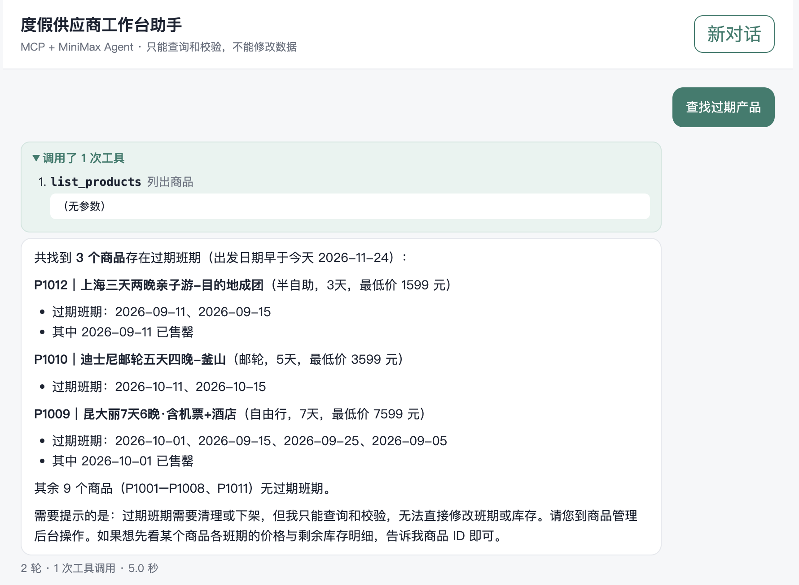
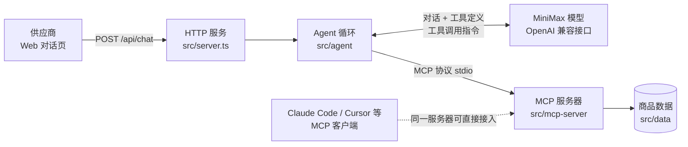

# 度假供应商工作台助手

面向度假产品供应商的 AI 助手：用自建的 MCP 服务器把商品、班期、库存数据暴露给大模型，由 MiniMax 模型驱动的 Agent 帮供应商查询商品、预警库存、在录入新商品前校验，并用评估集量化效果、驱动优化。

**在线演示：** 【线上地址】（访问密码请联系我）
**演示视频：** 【视频链接】



## 为什么做这个项目

我在携程做了 4 年多供应商管理平台（VBK），服务数千家度假供应商。供应商日常最常问的是"哪些班期快卖完了""哪些产品过期了""这个商品能不能上架"，而录入时的格式错误（如日期没补 0、标题夹带测试字样）会导致查询结果出错，而且错得很隐蔽。

这个项目尝试用 Agent 解决这些问题，并且只开放**查询和校验**权限：改价、改库存、提交商品仍需在后台操作。

## 架构



- **模型只负责决定"调用哪个工具、传什么参数"**，真正读取数据的是 MCP 服务器
- **MCP 服务器与模型解耦**：新增工具只需改服务器端，Agent 会通过 `listTools` 自动发现；同一服务器也能被其他 MCP 客户端直接使用

## 功能

| 工具 | 作用 |
| --- | --- |
| `list_products` | 商品概况：最低价、总库存、售罄班期、过期班期 |
| `get_product_detail` | 单个商品的完整信息和每个班期的价格库存 |
| `low_stock_alert` | 库存紧张和已售罄班期预警 |
| `price_calendar` | 某商品某月每个班期的价格 |
| `validate_product_draft` | 录入校验，区分"必须修改"和"建议核实" |

- **Agent Skill**：`skills/product-entry/` 封装了商品录入流程和录入规范，可在 Claude Code 中加载，也可嵌入自建 Agent
- **Web 对话页**：展示每次回答调用了哪些工具、传了什么参数、用了几轮和多少时间，支持多轮对话
- **权限边界**：Agent 只有查询和校验权限，越权请求（如"把价格改成 3000"）会明确拒绝

## 评估与优化

评估集共20条用例，覆盖 5 类场景：正常查询、无结果、含糊提问、录入校验、越权请求。

评分分两层：

1. **规则检查**（`src/evals/score.ts`）：是否调用了该调用的工具、答案是否包含关键信息、是否出现不该出现的内容、工具调用次数是否超过上限
2. **LLM 评委**（`src/evals/judge.ts`）：对规则判断不了的用例（如含糊提问），按自然语言写的评分标准判断回答质量

### 优化记录

| 版本 | 改动 | 通过率 | 说明 |
| --- | --- | --- | --- |
| baseline | 初始版本 | 【13/15】 | 【主要失败原因:把限制写得太严重，虽然让大模型查找一些确定的，但是大模型基于提供尽可能多的信息，总会给更多，造成case不通过，实在大模型的回答没有问题】 |
| v2 | 【把限制变得宽松】 | 【16/18】 | 【不会因为大模型给出了额外回答报错，发现相同case大模型给的回答往往也不一样】 |
| v3 | 【加入LLM评审来评测大模型的回答】 | 【20/20】 | 【所有case也不是稳定在100%的成功率，大模型的话术不尽相同】 |

### 案例：工具设计决定 Agent 效率

问"查找过期产品"时，Agent 最初调用了 15 次工具：没有一个工具能直接回答这个问题，模型只能逐个查询商品详情。

| 阶段 | 改动 | 工具调用次数 |
| --- | --- | --- |
| 1 | 原始设计 | 15 次 |
| 2 | 只在 `low_stock_alert` 描述里说明"可以查过期" | 模型不确定结果是否完整，仍逐个核对 |
| 3 | `list_products` 加入过期班期 | 5 次 |
| 4 | 改写 `list_products` 描述：给出"过期"的定义、明确用途、声明结果已完整 | 4 次 |

结论：模型根据工具的**名字和描述**决定怎么用工具，而不是根据它实际能做什么；工具描述本身就是 Prompt 工程的一部分。

### 案例：数据格式导致的隐蔽错误

班期日期 `"2026-9-15"` 月份没有补 0，字符串比较时被判定为晚于 `"2026-11-04"`，导致过期查询漏掉这个班期，并让 Agent 因结果对不上而反复核对。这类问题由 `validate_product_draft` 的日期格式校验和数据质量测试拦截。

## 运行

需要 Node.js 22 及以上。

```bash
npm install
cp .env.example .env        # 填入 MiniMax API Key
npm test                    # 单元测试，不调用 API
npm run chat                # 命令行对话
npm run eval                # 跑评估集，结果保存在 results/
npm run eval -- --tag v2    # 给本次评估打标签，方便对比
```

启动 Web 对话页（开发模式）：

```bash
npm run server              # 终端 1：后端，端口 3000
cd web && npm install && npm run dev   # 终端 2：前端，端口 5173
```

在 Claude Code、Cursor 等 MCP 客户端中使用这个 MCP 服务器，在项目根目录创建 `.mcp.json`：

```json
{
  "mcpServers": {
    "supplier-workbench": {
      "type": "stdio",
      "command": "npx",
      "args": ["tsx", "src/mcp-server/index.ts"]
    }
  }
}
```

## 部署

部署在【阿里云轻量应用服务器 / Ubuntu】上，前端打包后由后端统一提供，用 PM2 守护进程：

```bash
cd web && npm run build && cd ..
pm2 start npm --name supplier-agent -- run server
```

API Key 只保存在服务器环境中，不出现在前端代码和仓库里。

## 目录结构

```
├── src/
│   ├── data/          # 模拟商品数据
│   ├── mcp-server/    # MCP 服务器与工具实现
│   ├── agent/         # Agent 循环、模型调用、MCP 客户端
│   ├── evals/         # 评分规则、LLM 评委、评估脚本
│   ├── server.ts      # HTTP 接口
│   └── cli.ts         # 命令行对话
├── evals/cases.json   # 评估用例
├── skills/            # Agent Skill
└── web/               # React 对话页
```

## 说明

商品数据为模拟数据，结构参考了度假行业 B 端系统的常见设计，不包含任何真实业务数据。
